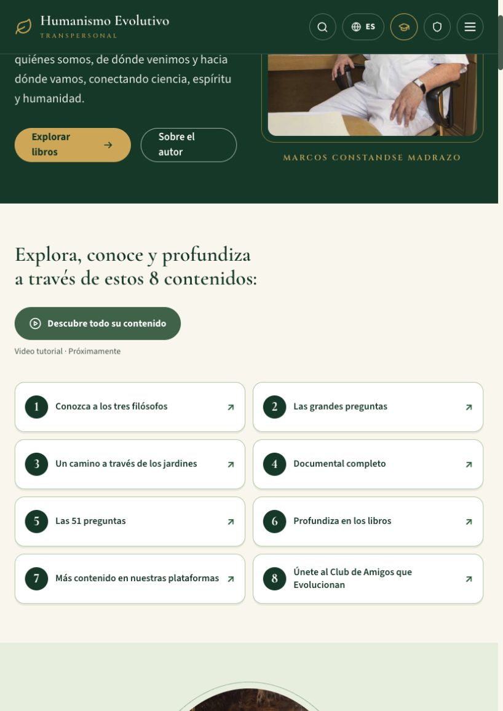
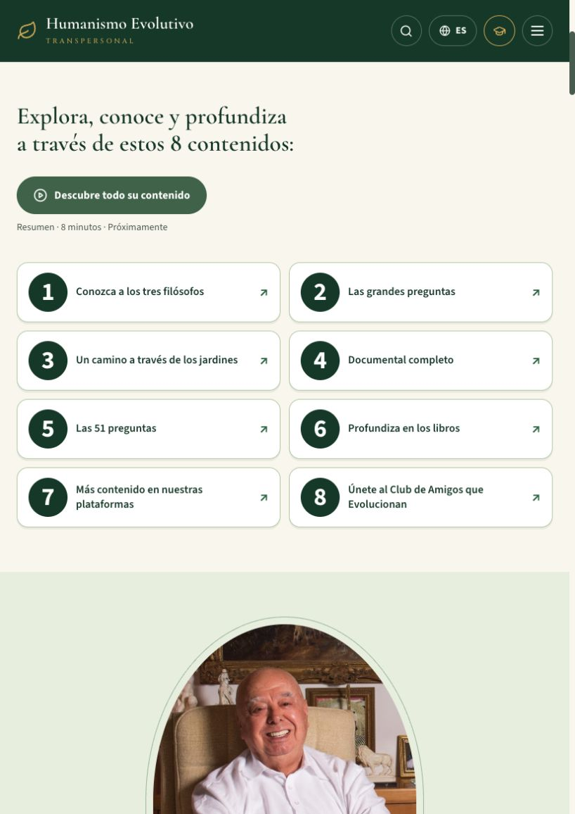
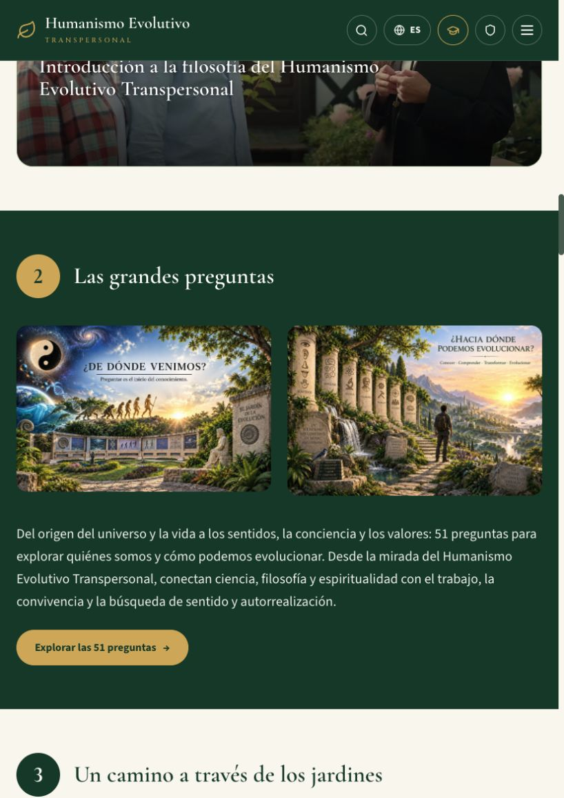
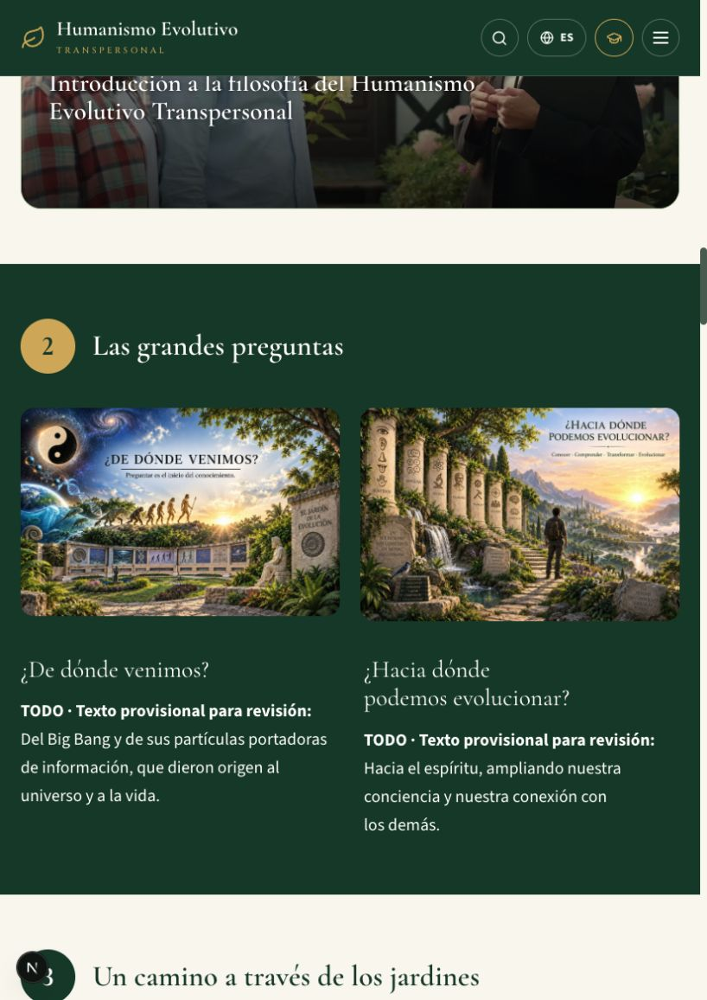
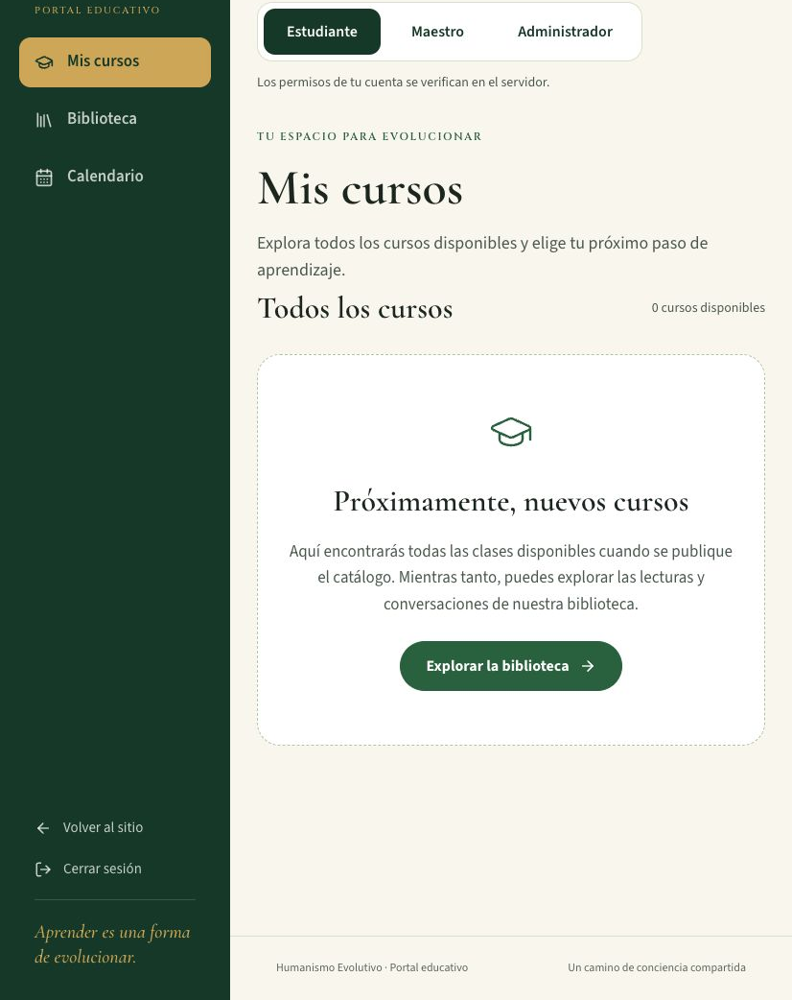
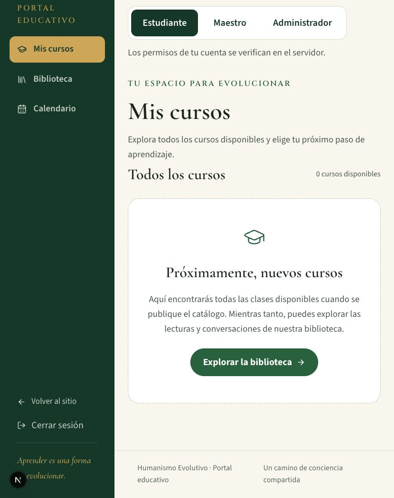

# Revisión del 20 de octubre de 2026

Rama: `fix/oct20-qa-review`. Base y destino del PR: `dev`, según `AGENTS.md` y el flujo de publicación. Referencia visual anterior: https://qa.humanismoevolutivo.com. La URL `humnanismo-evolutivo.vercel.app` pertenece al proyecto principal; el proyecto de QA está separado. No se ha desplegado ni promovido a producción.

## Cambios

- Navegación de ocho contenidos: números de 22 a 36 px, círculos de 38 a 56 px y tipografía sin serifas para distinguirlos mejor.
- Portal: base de 20 px, párrafos de 19 px, texto auxiliar de al menos 16 px y controles que heredan el tamaño. Se mantienen los saltos de diseño para móvil y tableta, con ajuste de líneas y foco visible.
- «Las grandes preguntas»: dos preguntas con respuestas breves, ambas marcadas **TODO · Texto provisional para revisión**. La colección de 51 preguntas conserva su sección y sus páginas independientes.
- Las 51 páginas ya existen en `/51preguntas/pregunta_1` hasta `/51preguntas/pregunta_51`, con título, descripción, texto narrado, navegación y espacio de video. Se añaden palabras clave específicas a sus metadatos. Las preguntas 26–51 ya muestran «El video de esta pregunta estará disponible próximamente».
- Los espacios de video de inicio se configuran en `src/config/videos.ts`, en orden: resumen de 8 minutos, introducción de los filósofos, documental de 47 minutos. El resumen pendiente permanece deshabilitado con «Próximamente». Se elimina el popup automático de bienvenida para respetar ese recorrido.
- El documental tenía un enlace a sí mismo y otro a un listado que contiene una conferencia distinta de 1:15:30. Se sustituyen por un espacio propio, deshabilitado hasta configurar su identificador verificado. No se atribuye al documental una URL desconocida.
- Registro: el enlace de confirmación ahora apunta a `/auth/confirm?next=…`, conservando el destino permitido. Antes se enviaba únicamente el origen y se omitía el manejador existente. El formulario aclara que Amigos que Evolucionan no requiere escuela. Los errores de Auth dejan un diagnóstico mínimo de código/estado en el servidor, sin correo, contraseña, tokens ni metadatos.

## Registro: evidencia y límites

**No se pudo reproducir el error de base de datos de la demostración. Su causa histórica sigue sin confirmar.** No presentar el cambio de confirmación como reparación demostrada de ese error.

Se realizó una petición real `auth.signUp` al proyecto compartido `iwtcdjkawcjsxmwhzlot`, con clave pública y un correo único del dominio reservado `example.invalid`. Resultado: sin error, usuario creado y sesión emitida. No requiere escuela. Se creó una identidad de prueba sin destinatario de correo real; no se guardaron contraseña, tokens ni identificador en el repositorio. Esta prueba directa del proveedor no equivale a una prueba integral del formulario desplegado.

Seguimiento con la hora indicada: 20 de octubre, 13:30 de Nueva York (17:30 UTC). Se consultó la ventana 13:15–13:45 y el servicio de logs no devolvió eventos de ninguna fuente. Por tanto, no hay cobertura disponible en esa ventana para confirmar ni descartar el fallo.

La inspección de solo lectura no encontró triggers personalizados en `auth.users`. En los registros disponibles del 20 de octubre (hora de Nueva York) no aparecieron errores de base de datos de Auth/Postgres. Sí apareció un intento de registro repetido (`user_already_exists`), que no demuestra la causa del fallo de la demo. Los registros privados y datos de cuentas no se incluyen aquí.

Defecto independiente confirmado por código: `emailRedirectTo` recibía la raíz, mientras el intercambio PKCE/verificación OTP vive en `/auth/confirm` y `/auth/callback`. Se corrigió el destino. En proyectos con confirmación habilitada hay que permitir la URL de confirmación de QA en la configuración de Auth; no se modificó la configuración compartida.

Se añaden pruebas del SDK con transporte simulado: registro correcto sin escuela, normalización de nombres/correo, enlace de confirmación utilizable y propagación de un error 500 de base de datos. La prueba exitosa cubre también el caso sin sesión, que requiere confirmación de correo.

## Roles y Amigos que Evolucionan

| Rol solicitado | Hallazgo |
| --- | --- |
| estudiante | Contrato y autorización implementados como `student` en la migración; vista de estudiante disponible. |
| maestro | Contrato `teacher`, limitado a su escuela activa; pruebas de aislamiento y denegación de acceso cruzado. |
| escuela | **No existe como rol de acceso.** Una escuela es una agrupación. Darle identidad/permisos propios exige definir un rol y su alcance. |
| administrador | Capacidad de fundación mediante `authz.assert_current_admin_permission('education.qa.manage')`; no depende de metadatos editables del usuario. |

**Brecha de activación:** el esquema `education_qa_private` no existe en la base compartida inspeccionada. La migración de escuelas está en el repositorio, pero no aplicada. El portal desplegado muestra vistas de demostración para maestro/administrador; cambiar la vista no concede permisos reales. No se puede afirmar que los cuatro roles estén operativos y verificados en QA.

El registro de Auth funciona sin escuela. La asignación automática a **Amigos que Evolucionan** está implementada al entrar al portal habilitado, pero depende de esa migración y del interruptor `EDUCATION_ACCESS_ENVIRONMENT=qa`. Las pruebas existentes la verifican en PostgreSQL aislado, junto con protección contra escalamiento y acceso entre escuelas. La activación y un cuarto rol no son cambios pequeños; se reportan sin aplicarlos al proyecto compartido con producción.

Además, el catálogo actual de cursos del portal muestra cero cursos aunque la portada anuncia cuatro/146 clases. Es una brecha preexistente de contenido, fuera de estos cambios tipográficos.

## Verificación

- `npm test`: 39 pruebas, incluidas pruebas de autorización en PostgreSQL aislado y dos regresiones nuevas de registro.
- `npx tsc --noEmit --incremental false` y `npm run lint`.
- Las 51 páginas HTML generadas se comprobaron individualmente: título, descripción, palabras clave, texto narrado y reproductor o aviso de video pendiente.
- Compilación con `OCC_RESOURCES_ALLOW_SNAPSHOT=true npm run build` (instantánea local; no sincroniza contenido privado ni despliega).
- Revisión visual de inicio y portal en tableta (826 px) y móvil (390 px mediante iframe con viewport propio). Las imágenes del portal posterior usan el componente real con una identidad ficticia en una ruta temporal local; esa ruta se elimina antes del commit. La imagen anterior del portal se recorta para excluir datos de cuenta.
- Contraste calculado de las combinaciones de texto modificadas, entre 4.97:1 y 11.77:1 (mínimo AA de 4.5:1); no constituye una auditoría WCAG completa de todo el sitio.

## Capturas

| Vista | Antes (QA) | Después (local) |
| --- | --- | --- |
| Números |  |  |
| Grandes preguntas |  |  |
| Portal |  |  |

Capturas móviles: [números](screenshots/numbers-mobile.png), [preguntas](screenshots/questions-mobile.png), [portal](screenshots/portal-mobile.png).

## TODO pendientes

1. Aprobar el texto final de las dos grandes preguntas con Ing. Marcos Constandse.
2. Entregar/configurar el video resumen de 8 minutos.
3. Verificar/configurar la URL del documental completo de 47 minutos.
4. Entregar los videos de las preguntas 26–51.
5. Obtener el texto exacto o request ID del fallo de registro original si vuelve a ocurrir (hora indicada: 13:30); contrastarlo con los nuevos códigos de diagnóstico. No hay una causa de base de datos demostrada ni un cambio de esquema justificado por la evidencia actual.
6. Definir los permisos de `escuela`, activar la infraestructura de escuelas en el entorno aprobado y verificar los roles con cuentas de prueba de cada alcance.
7. Revisar la publicación del catálogo de cursos del portal y su correspondencia con la portada.
